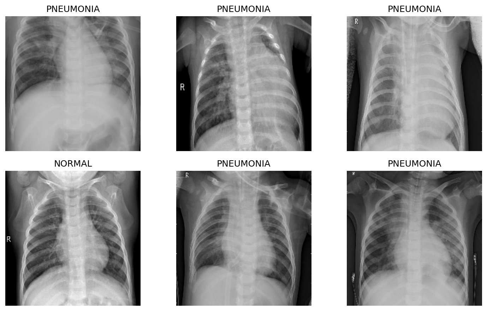
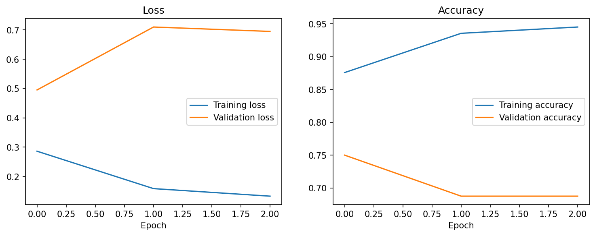
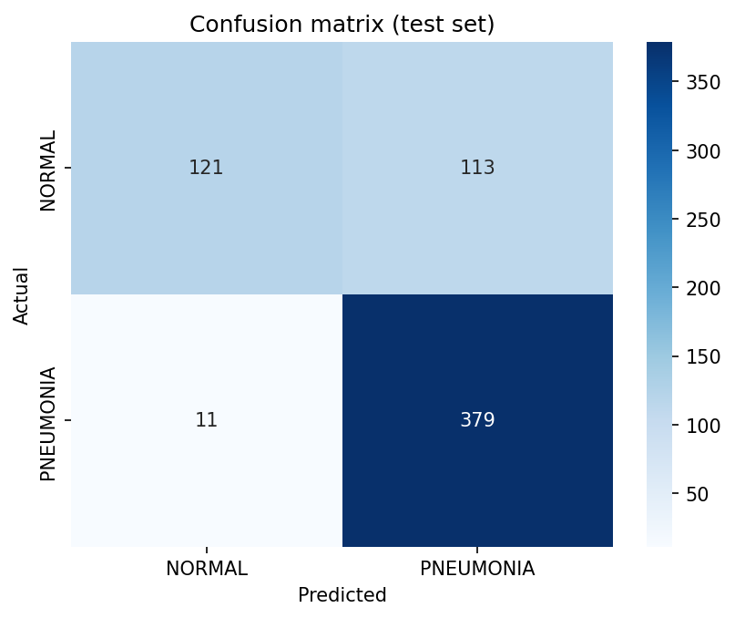
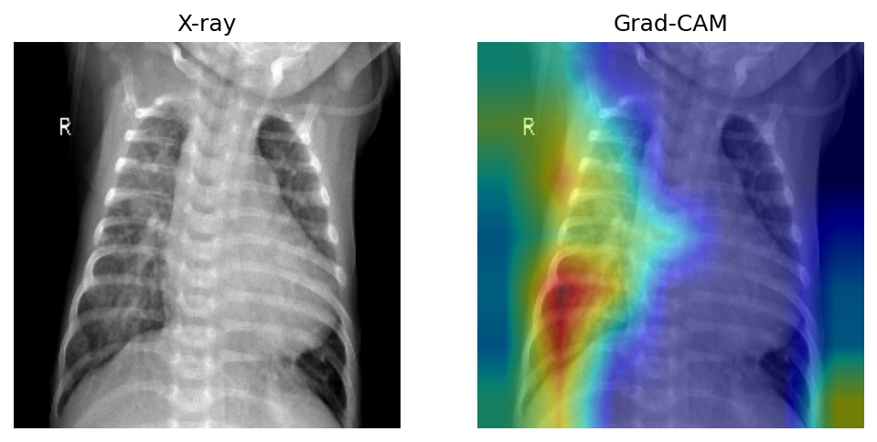

# Pneumonia Detection from Chest X-Rays

Classifying chest X-ray images as normal or pneumonia: a binary image classification problem solved with deep learning and transfer learning. This project walks the full computer vision pipeline, from loading images to an evaluated, explainable model.

## Problem

Pneumonia is a serious lung infection that is often diagnosed from chest X-ray images by trained radiologists. In many parts of the world, access to radiologists is limited, so an automated system that can flag likely pneumonia from an X-ray could support faster screening and triage. The aim of this project is to build and evaluate such an image classifier.

Formally, given a chest X-ray image, the task is to predict whether it shows **pneumonia (1)** or is **normal (0)**. This is a binary image classification problem.

**Why this problem is hard:**

- **Small, specialised data.** Medical image datasets are far smaller than everyday image datasets, which makes training a deep network from scratch prone to overfitting. Transfer learning (reusing a model pretrained on millions of general images) is the standard solution.
- **Asymmetric error costs.** Missing a real pneumonia case (false negative) is more dangerous than a false alarm, so recall (sensitivity) is the priority metric, not plain accuracy.
- **Need for trust.** A prediction alone is not enough in a clinical context. Grad-CAM heatmaps are used to show which regions of the X-ray the model focused on, making its decisions inspectable.

**Why it matters:** medical imaging is one of the highest-impact applications of machine learning, and the techniques here (transfer learning, handling small data, the right metrics, and visual explainability) apply broadly across computer vision.

## Dataset

- **Name:** Chest X-Ray Images (Pneumonia)
- **Original source:** Kermany et al., *Cell* (2018), a peer-reviewed study using real pediatric chest X-rays. Mirrored on Kaggle (`paultimothymooney/chest-xray-pneumonia`).
- **Size:** about 5,800 X-ray images, organised into `train`, `val`, and `test` folders, each split into `NORMAL` and `PNEUMONIA`.
- **Format:** JPEG images in a folder structure (no CSV).

> The raw images are not committed to this repo (see `.gitignore`). The notebook downloads them automatically from Kaggle. A Kaggle API key (`kaggle.json`) is provided once when the first cell asks for it.

## Approach

| Pipeline stage | What this project does |
|---|---|
| Framing | Binary image classification; recall prioritised over accuracy |
| Data loading | Load images from folders into a TensorFlow dataset |
| Splitting | Train / validation / test sets |
| Preprocessing | Resize, normalize, data augmentation (flips, rotations) |
| Baseline model | A small CNN trained from scratch |
| Main model | Transfer learning with a pretrained CNN (ResNet), freeze then fine-tune |
| Anti-overfitting | Dropout and early stopping |
| Training diagnostics | Loss and accuracy curves for train vs. validation |
| Tuning | Hyperparameter tuning |
| Evaluation | Recall, ROC-AUC, F1, confusion matrix (not accuracy alone) |
| Explainability | Grad-CAM heatmaps showing where the model looks |

## Results

Evaluated on the held-out test set of 624 chest X-rays using the ResNet50 transfer-learning model (frozen, then fine-tuned).

| Metric | Value |
|---|---|
| ROC-AUC | **0.941** |
| Recall (pneumonia caught) | **97.2%** |
| Precision | **77.0%** |
| F1 score | **0.859** |
| Accuracy | **80.1%** |

**Confusion matrix (test set):**

| | Predicted Normal | Predicted Pneumonia |
|---|---|---|
| **Actual Normal** | 121 | 113 |
| **Actual Pneumonia** | 11 | 379 |

The model caught **379 of 390 pneumonia cases (97.2% recall)** and missed only 11. The trade-off is lower precision: 113 normal X-rays were flagged as pneumonia.

**Interpretation:** this is a deliberate and clinically sensible balance. In a screening context, a missed pneumonia case (false negative) is far more dangerous than a false alarm (false positive), so high recall is prioritised over precision. A tool like this would flag likely cases for a clinician to confirm, rather than make a final diagnosis. The flagged-but-normal cases are the cost of catching nearly every real case.

### Figures

**Sample X-rays from the training set.**



I plotted a batch of training images with their labels as a first sanity check, to confirm the data loaded correctly and to see what the model is working with. The images are pediatric chest X-rays of varying size, contrast, and positioning, and both classes (NORMAL and PNEUMONIA) are present. This step also surfaces the practical messiness of real medical images (different framing, brightness, and annotation marks such as the "R" label), which is why resizing, normalisation, and augmentation are applied before training.

**Training and validation curves.**



These curves track loss and accuracy across epochs for the transfer-learning model. Training loss falls steadily and training accuracy climbs toward 0.95, so the model fits the training data well. The validation curves tell the more important story: validation loss rises and validation accuracy drops after the first epoch. This is a clear sign of overfitting, and it is driven mainly by the dataset's very small built-in validation folder (only a handful of images), which makes the validation signal noisy and easy to diverge from. Reading this diagnostic is the reason the final judgement of the model is made on the much larger held-out test set rather than on the validation curves, and it motivates the dropout, augmentation, and early stopping used in the pipeline.

**Confusion matrix on the test set.**



The matrix compares predictions (columns) against the true labels (rows) on the 624-image test set. The model correctly identified 379 of the 390 pneumonia cases (bottom-right) and missed only 11 (bottom-left), which is the high recall the project aims for. Among normal X-rays, 121 were correctly cleared (top-left) but 113 were flagged as pneumonia (top-right). The pattern is deliberate: the model leans toward flagging rather than missing, which in a screening setting is the safer error to make.

**Grad-CAM explainability.**



Grad-CAM overlays a heatmap on the X-ray showing which regions most influenced the prediction, from blue (low influence) to red (high influence). In this example the model's attention concentrates on the lung field rather than on the image borders or background, which is reassuring: it suggests the prediction is based on the chest region itself rather than on irrelevant artefacts. Making the model inspectable this way is important for a project in a sensitive domain, and it provides a check against the model learning shortcuts.

## How to run

### Option A: Google Colab (recommended)

1. Open `notebooks/pneumonia_detection.ipynb` in [Google Colab](https://colab.research.google.com).
2. Enable the GPU: Runtime > Change runtime type > GPU. This speeds up training a lot.
3. Run the first cell and select the `kaggle.json` key when the "Choose Files" button appears. The dataset downloads automatically.
4. Run the remaining cells top to bottom.

### Option B: Local

```bash
pip install -r requirements.txt
jupyter notebook notebooks/pneumonia_detection.ipynb
```

A GPU is strongly recommended for training.

## Limitations

- The dataset is pediatric X-rays from one source, so results may not generalise to other populations or equipment.
- This is a portfolio project, not a medical device. It is not validated for clinical use and must not be used for real diagnosis.

## License

MIT. See [LICENSE](LICENSE).
